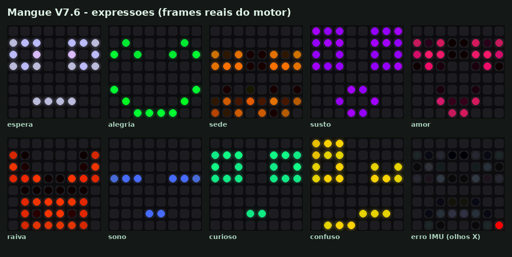
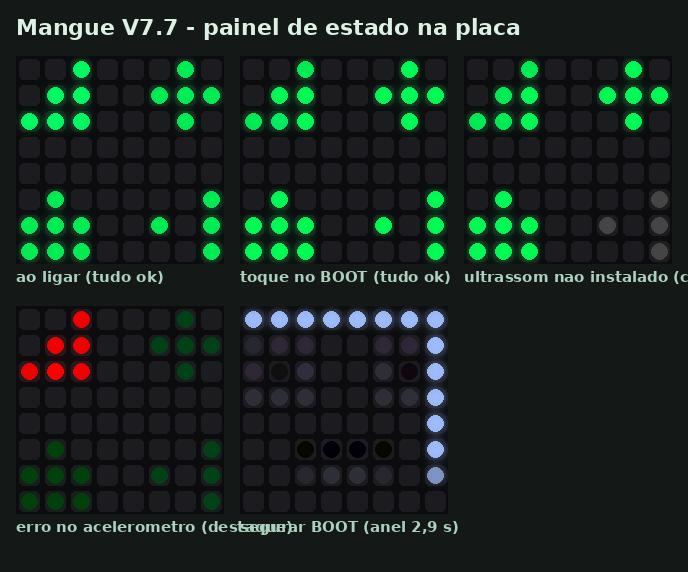
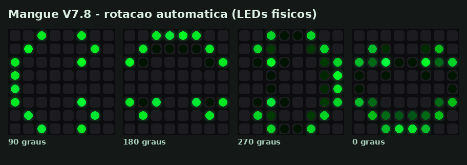
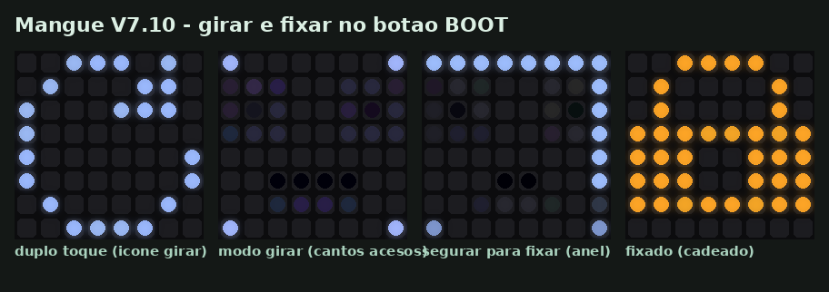
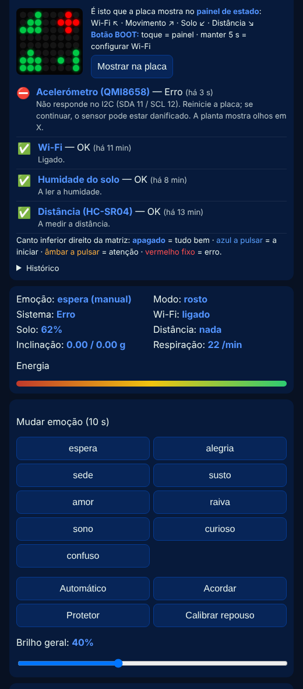
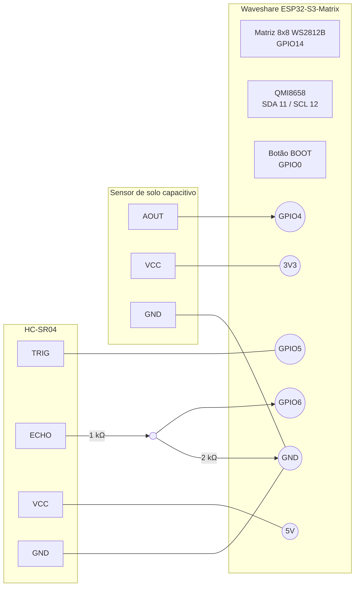

# 🌱 Mangue Interativo

**Uma planta física com rosto, humor e respiração**, construída sobre a placa **Waveshare ESP32-S3-Matrix**. Ela reage ao movimento, à aproximação de pessoas e à umidade do solo; expressa emoções numa matriz de LED 8×8; e oferece uma página web para acompanhar e personalizar tudo — sem um único `delay()`.

> Versão do firmware: **7.11 "Organismo Sereno"** · Plataforma: Arduino (arduino-esp32 2.x/3.x) · Idioma do código: português

| | |
|---|---|
|  |  |
| *As 9 expressões (frames reais do motor visual)* | *Painel de estado na própria placa* |
|  |  |
| *Rotação automática: o que os LEDs mostram com a placa a 90°, 180°, 270° e 0°* | *Girar e fixar pelo botão BOOT* |

---

## Sumário

1. [O que é](#1-o-que-é)
2. [Funcionalidades](#2-funcionalidades)
3. [Hardware e ligações](#3-hardware-e-ligações)
4. [Instalação](#4-instalação)
5. [Primeira utilização](#5-primeira-utilização)
6. [Como usar](#6-como-usar)
7. [API REST](#7-api-rest)
8. [Arquitetura do firmware](#8-arquitetura-do-firmware)
9. [Configuração (`#define`)](#9-configuração-define)
10. [Decisões de projeto e evidências](#10-decisões-de-projeto-e-evidências)
11. [Banco de testes](#11-banco-de-testes)
12. [Limitações conhecidas](#12-limitações-conhecidas)
13. [Roadmap](#13-roadmap)
14. [Histórico de versões](#14-histórico-de-versões)
15. [Autoria, créditos e licença](#15-autoria-créditos-e-licença)
16. [Notas sobre o uso de IA Generativa (IAG)](#16-notas-sobre-o-uso-de-ia-generativa-iag)
17. [Referências](#17-referências)

---

## 1. O que é

O **Mangue Interativo** transforma um vaso de planta num pequeno ser expressivo. Um "cérebro" ESP32-S3 com matriz RGB 8×8 lê sensores, mantém um estado emocional e de energia, e desenha um rosto vivo — que respira, olha à volta, segue a inclinação, fica curioso quando alguém se aproxima, tem sede quando o solo seca e adormece quando ninguém interage.

O projeto tem três objetivos:

- **Expressivo** — comunicar estados de forma imediata e afetiva, numa resolução de apenas 64 pixels.
- **Robusto** — multitarefa real (tudo com `millis()`), recuperação automática de falhas de sensores e de rede.
- **Usável** — sinalização de sistema separada das emoções, diagnóstico na própria placa e na web, decisões baseadas em medições.

---

## 2. Funcionalidades

### 2.1 Rosto procedural
O rosto não é um bitmap fixo: é **composto** por olhos (7 formas), boca (9 formas) e sobrancelhas, combinados numa tabela de expressões.

| Emoção | Olhos | Boca | Gatilho principal | Respiração |
|---|---|---|---|---|
| **espera** | abertos | neutra | estado de repouso | 10/min |
| **alegria** | `^ ^` | sorriso | interação recente | 14/min |
| **sede** | semicerrados | ondulada | solo < 30% (sai > 40%) | 8/min |
| **susto** | arregalados | "O" | sacudida > 0,8 g ou aproximação brusca | 24/min |
| **amor** | corações | beijo | pessoa por perto > 8 s com energia > 50 | 12/min |
| **raiva** | inclinados `\ /` | dentes | 3 sustos em 10 s | 22/min |
| **sono** | fechados | pequena | energia < 20 | 6/min |
| **curioso** | abertos | pequena | pessoa a < 60 cm | 16/min |
| **confuso** | assimétricos | torta | Wi-Fi caiu (reação de 4 s) | 12/min |

As transições entre rostos e cores são **suaves** (crossfade de 900 ms; cor interpolada no espaço perceptual OKLCh).

### 2.2 Vida e movimento
- **Respiração por tamanho** — o rosto cresce e encolhe (reamostragem por área, subpixel) com brilho praticamente constante. Nada pisca.
- **Olhar com física** — pupilas com mola-amortecedor ("olhos de boneco"): rolam para o lado mais baixo ao inclinar a placa; olham em frente para quem está perto; ficam vesgas a < 12 cm; sem estímulo, fazem sacadas calmas (a cada 3–7 s).
- **Energia (0–100)** — cai com o tempo e com sede, sobe com interação e repouso; modula humor, ritmo respiratório e brilho.
- **Rotação automática** — com a placa de pé, o rosto (e também painel, indicador e avisos) gira 90°/180°/270° para ficar sempre direito quando um dos lados está a **menos de 15° do horizonte**. O giro é animado; entre as janelas de 15° a orientação se mantém (sem oscilar); é preciso ficar 0,4 s na nova posição; com a placa deitada nada muda. O olhar e a posição de repouso acompanham a nova orientação.
- **Girar ↺↻ e fixar 🔒** — manipulação direta, como o bloqueio de rotação do celular: se o rosto ficar torto, segure a placa direita e toque em girar até ficar direito — em modo automático a planta **aprende** a correção do sensor e continua a girar sozinha e certa; em modo **fixo**, o rosto fica na posição escolhida. Disponível na página e no botão BOOT (duplo toque).
- **Despertar e adormecer** — pálpebras abrem ao ligar; após 90 s sem interação, a planta adormece e entra o **protetor de tela** (Maré, Jogo da Vida, Vaga-lumes).

### 2.3 Sinalização de sistema (3 camadas, separada das emoções)
| Camada | Onde | Diz | Quando |
|---|---|---|---|
| 1. Indicador | pixel do canto inferior direito | *há* algo e a gravidade | sempre que há algo |
| 2. Painel de estado | matriz inteira, 4 ícones | ***qual*** componente | ao ligar · toque no BOOT · botão web · sozinho num erro novo |
| 3. Recuperação | botão BOOT mantido 5 s | reabre a configuração Wi-Fi | sob demanda |

Código de cores (sempre **cor + padrão**, nunca piscando): **apagado** = tudo bem · **azul pulsando** = iniciando · **âmbar pulsando** = atenção · **vermelho fixo** = erro · **cinza** = não instalado.

### 2.4 Página web
Espelho ao vivo da matriz (sempre "em pé", como a pessoa vê) · selo de estado geral · painel "Saúde do sistema" (o quê, desde quando, o que fazer) · histórico de eventos · emoções manuais · orientação (🔄 automática / 🔒 fixa, ↺ ↻, ângulo medido, montagem do sensor, calibração completa) · brilho geral · 5 paletas + cor única · teste/ajuste da ordem de cor dos LEDs · aviso "Sem conexão com a planta". Tema da página acompanha a paleta.



---

## 3. Hardware e ligações

### 3.1 Lista de materiais

| Item | Obrigatório | Observação |
|---|---|---|
| Waveshare **ESP32-S3-Matrix** | ✅ | Matriz WS2812B 8×8 (GPIO14) e IMU QMI8658 (I2C) já na placa |
| Cabo USB-C (dados) | ✅ | Alimentação e gravação |
| Sensor de umidade do solo **capacitivo** (ex.: v1.2) | opcional | Detectado automaticamente; sem ele a planta não sente sede |
| Sensor ultrassônico **HC-SR04** | opcional | Detectado automaticamente; exige divisor de tensão no ECHO |
| Resistores 1 kΩ + 2 kΩ | se usar HC-SR04 | Divisor 5 V → 3,3 V |
| DHT11/22, APDS9960 | futuro | Ainda **não** integrados no firmware (ver [Roadmap](#13-roadmap)) |

### 3.2 Mapa de pinos

| Função | GPIO | Origem | Notas |
|---|---|---|---|
| Matriz WS2812B (DIN) | **14** | na placa | Ordem de cor **RGB** (ajustável na web) |
| I2C SDA (QMI8658) | **11** | na placa | Endereço 0x6B (alternativo 0x6A) |
| I2C SCL (QMI8658) | **12** | na placa | 400 kHz |
| Botão BOOT | **0** | na placa | LOW = pressionado; pino de *strapping* (não pressione ao energizar, a menos que queira gravar) |
| Umidade do solo (AOUT) | **4** | externo | ADC1 — funciona com Wi-Fi ativo (o ADC2 não) |
| HC-SR04 TRIG | **5** | externo | ⚠️ confirme que o GPIO está livre/exposto na sua revisão da placa |
| HC-SR04 ECHO | **6** | externo | ⚠️ **5 V → use divisor**; o ESP32-S3 não tolera 5 V |

### 3.3 Esquema de ligações



Ligações em texto:

```
Sensor de solo         ESP32-S3-Matrix
  VCC  ──────────────── 3V3      (3,3 V mantém a saída analógica ≤ 3,3 V)
  GND  ──────────────── GND
  AOUT ──────────────── GPIO4

HC-SR04                ESP32-S3-Matrix
  VCC  ──────────────── 5V       (ou fonte externa de 5 V com GND comum)
  GND  ──────────────── GND
  TRIG ──────────────── GPIO5    (3,3 V é suficiente para disparar)
  ECHO ──[1 kΩ]──┬───── GPIO6
                 └─[2 kΩ]── GND  (5 V × 2/3 ≈ 3,3 V)
```

> ⚠️ **Alimentação**: se a sua revisão da placa não expuser 5 V, alimente o HC-SR04 com uma fonte de 5 V externa e **una os GNDs**. Confirme sempre o pinout da sua placa na wiki da Waveshare antes de ligar.

---

## 4. Instalação

1. **Arduino IDE** 2.x → *Boards Manager* → instale **esp32** (Espressif), versão 2.x ou 3.x.
2. **Bibliotecas** (*Library Manager*):
   - **Adafruit NeoPixel**
   - **WiFiManager** (tzapu), **≥ 2.0** — necessária para `getConfigPortalActive()` e o modo não bloqueante.
   - `WebServer`, `ESPmDNS`, `Preferences`, `Wire` já vêm com o core ESP32.
3. **Placa**: *ESP32S3 Dev Module* · **USB CDC On Boot: Enabled** (para o Monitor Serial pela USB nativa) · *Flash Size* conforme o seu módulo (a ESP32-S3-Matrix usa 4 MB).
4. Abra `Mangue_Interativo_V7/Mangue_Interativo_V7.ino` e grave.
5. Monitor Serial a **115200** baud para ver o diagnóstico (`[IMU]`, `[SAUDE]`, `[REDE]`, `[ESTADO]`…).

> Se a gravação falhar: segure **BOOT**, pressione **RESET**, solte **BOOT** e grave de novo.

---

## 5. Primeira utilização

### 5.1 Ao ligar
A matriz mostra a **verificação inicial**: quatro ícones acendem um a um (verde = OK, azul = verificando, cinza = não instalado). Em ≤ 6 s, as pálpebras abrem e a planta acorda.

### 5.2 Conectar ao Wi-Fi
1. Sem rede salva, a planta cria a rede **`Mangue_Interativo_AP`** (indicador âmbar no canto).
2. Conecte o celular/computador a essa rede; o portal abre sozinho (ou acesse `http://192.168.4.1`).
3. *Configure WiFi* → escolha a sua rede **2,4 GHz** → senha → salvar.

Para trocar de rede depois: **segure o BOOT por 5 s** (a moldura enche como uma barra de progresso; soltar antes cancela).

### 5.3 Abrir a página
Na mesma rede: **`http://mangue.local`** (iPhone, Mac, Linux, Windows 10/11) ou o IP mostrado no Monitor Serial (`[WEB] http://192.168.x.x`). Muitos Android não resolvem `.local` — use o IP e, de preferência, reserve-o no roteador.

### 5.4 Checklist de calibração
1. **Cores**: na página, *Cores dos LEDs → Testar cores*. A placa deve mostrar **vermelho → verde → azul**. Se não, mude a ordem no seletor (fica salva).
2. **Repouso**: deixe a placa parada ~1 s ao ligar (`[IMU] Repouso calibrado`). Mudou a montagem? *Calibrar repouso*.
3. **Eixos**: incline para a direita — as pupilas devem ir para a direita. Senão, ajuste `EIXO_INVERTER_X/Y` ou `EIXO_TROCAR_XY`. Rosto rodado? `ROTACAO_MATRIZ`.
4. **Rotação**: com a placa de pé, o rosto deve ficar direito (boca para o chão). Se ficar torto, toque **↻** (página) ou faça **duplo toque no BOOT** e toque até ficar direito — a correção fica salva. Gire então a placa nas 4 posições para conferir. Se em algumas posições acertar e noutras ficar 180° errado, a montagem é espelhada: use **Calibração completa (2 passos)**.
5. **Solo**: anote o campo `mv` de `/api/estado` com o sensor no ar (`SOLO_MV_SECO`) e na água (`SOLO_MV_MOLHADO`).
6. **Brilho**: ajuste o controle "Brilho geral" (padrão 40%).

---

## 6. Como usar

### 6.1 Ler a placa
| Você vê | Significa |
|---|---|
| Rosto com cor da paleta, respirando | Emoção atual (só emoções usam o rosto) |
| Canto inferior direito apagado | Tudo bem |
| Canto azul pulsando | Iniciando algo |
| Canto âmbar pulsando | Atenção (ex.: Wi-Fi perdido, portal aberto) |
| Canto vermelho fixo + olhos em X | Erro do acelerômetro |
| 4 ícones na matriz | Painel de estado: ↖ Wi-Fi · ↗ Movimento · ↙ Solo · ↘ Distância |
| Ícone Wi-Fi desenhando-se arco a arco | Problema de rede (aparece 1×, e de novo só quando alguém chega) |
| Moldura enchendo | BOOT pressionado: aos 5 s abre a configuração Wi-Fi |
| Rosto girando | A placa foi posta de lado: o rosto se ajusta ao novo "chão" |
| Ícone ↻ e 4 cantos acesos | Modo girar (duplo toque no BOOT): toque = girar 90°, segurar 1,5 s = fixar/soltar |
| Cadeado laranja / aberto verde | Orientação fixada / voltou à automática |

### 6.2 Botão BOOT
- **Toque curto** → mostra/fecha o painel de estado.
- **Duplo toque** → modo girar: cada toque gira o rosto 90° ↻; **segurar 1,5 s** fixa/solta a orientação (cadeado); sai sozinho após 10 s.
- **Segurar 5 s** → reabre o portal Wi-Fi por 3 min.

### 6.3 Interagir com a planta
Inclinar (o olhar segue) · pôr de lado ou de cabeça para baixo (o rosto gira) · sacudir (susto; 3× = raiva) · aproximar-se (curiosidade → amor) · regar (sai da sede) · deixá-la quieta (sono → protetor).

---

## 7. API REST

| Método | Rota | Parâmetros | Função |
|---|---|---|---|
| GET | `/` | — | Página web |
| GET | `/api/estado` | — | Emoção, modo, energia, sensores, sistema, paleta (JSON) |
| GET | `/api/saude` | — | Estado por componente + histórico (JSON) |
| GET | `/api/matriz` | — | 64 pixels `RRGGBB` (384 caracteres) — espelho |
| POST | `/api/emocao` | `nome` (ou `auto`), `duracao` (1–600 s) | Emoção manual |
| POST | `/api/brilho` | `valor` (5–100) | Brilho geral (salvo) |
| POST | `/api/paleta` | `nome` (`mangue`, `oceano`, `por_do_sol`, `pastel`, `floresta`, `cor_unica`), `cor` (`RRGGBB`) | Paleta (salva) |
| POST | `/api/ordem` | `nome` (`RGB`, `GRB`, `BRG`, `RBG`, `GBR`, `BGR`) | Ordem de cor dos LEDs (salva) |
| POST | `/api/teste_cor` | — | Teste vermelho/verde/azul (6 s) |
| POST | `/api/painel` | — | Mostra o painel de estado na placa |
| POST | `/api/rotacao` | `auto` (`1`/`0`) | Automática / fixa na posição atual (salva) |
| POST | `/api/girar` | `sentido` (`1` = ↻, `-1` = ↺) | Gira o rosto 90° (aprende a correção se automática) |
| POST | `/api/orientacao` | `passo` (`1`, `2`, `repor`) | Calibração completa da montagem do sensor |
| POST | `/api/acordar` | — | Acorda a planta |
| POST | `/api/protetor` | — | Força o protetor de tela |
| POST | `/api/calibrar` | — | Recalibra a posição de repouso |

Exemplo: `curl -X POST "http://mangue.local/api/paleta?nome=cor_unica&cor=FF8800"`

---

## 8. Arquitetura do firmware

Arquivo único, organizado por módulos numerados:

```
1  Configuração (#define)        8   Visual: respiração + cor OKLCh
2  Tipos e estado global         9   Visual: rosto procedural + olhar
3  Utilitários                   10  Visual: protetores de tela
4  Emoções & energia             11  Visual: modos de tela e avisos
4b Saúde do sistema (UX)         12  Compositor (camadas → LEDs)
5  Sensor QMI8658 + orientação   13  Rede & servidor web
6  Sensor HC-SR04 (interrupção)  14  Diagnóstico
7  Sensor de solo (ADC1)         15  setup() & loop()
```

**Princípios**
- **Zero `delay()`**: cada módulo é chamado a cada volta do `loop()` e decide sozinho, com `millis()`, se tem trabalho. Única espera: o pulso de 10 µs do HC-SR04.
- **Máquinas de estado**: `Emocao`, `StatusHardware`, `ModoEcra`, `EstadoRede`, `Saude`; inicialização do IMU (procurar → reset → configurar → ativo) com *backoff* exponencial.
- **Dados em tabelas**: expressões, paletas, ícones e ordens de cor são tabelas (`static_assert` garante que estão completas).

**Pipeline visual (a cada 10 ms)**

```
desenho procedural → crossfade → escala (respiração) → cor (paleta, OKLCh)
  → aviso Wi-Fi → protetor → painel de estado → dithering temporal
  → indicador de sistema → anel do BOOT → [vista = espelho da web]
  → rotação para a orientação física (permutação exata; bilinear durante o giro) → LEDs
```

---

## 9. Configuração (`#define`)

| Constante | Padrão | Para quê |
|---|---|---|
| `USAR_SENSOR_SOLO` / `USAR_ULTRASSOM` | 1 / 1 | Desativar sensores no código |
| `PINO_US_TRIG` / `PINO_US_ECHO` | 5 / 6 | Pinos do HC-SR04 |
| `SOLO_MV_SECO` / `SOLO_MV_MOLHADO` | 2800 / 1200 | Calibração do solo (mV) |
| `ROTACAO_MATRIZ` | 0 | 0/1/2/3 = 0°/90°/180°/270° |
| `EIXO_TROCAR_XY`, `EIXO_INVERTER_X/Y` | 0 | Orientação do IMU |
| `ORDEM_COR_PADRAO` | 0 (RGB) | Ordem de cor inicial |
| `AUTO_ROTACAO_PADRAO` | 1 | Rotação automática (ajustável na web) |
| `CORRECAO_EIXOS_PADRAO` / `ESPELHO_EIXOS_PADRAO` | 1 / 0 | Montagem do QMI8658 face à matriz (+90°; ajustável por girar/calibração) |
| `LIMIAR_ROTACAO_GRAUS` | 15 | Janela em torno de 0/90/180/270° |
| `VERTICAL_MAX_GRAUS` | 40 | Só gira com a matriz a ≤ 40° da vertical |
| `ROTACAO_ESTAVEL_MS` / `DURACAO_ANIM_ROTACAO_MS` | 400 / 450 | Estabilidade exigida / duração do giro |
| `BRILHO_GERAL_PADRAO` | 40 % | Brilho inicial (ajustável na web) |
| `BRILHO_BASE` | 0,22 | Brilho do rosto |
| `PISCAR_OLHOS` | 0 | 1 = pestanejar ocasional |
| `INTERVALO_FRAME_MS` | 10 | 100 FPS (se o Wi-Fi ficar lento, use 20) |
| `USAR_DITHERING` | 1 | Suavidade em brilho baixo |
| `TEMPO_PROTETOR_MS` | 90000 | Inatividade até dormir |
| `NOME_AP_CONFIG` / `NOME_MDNS` | `Mangue_Interativo_AP` / `mangue` | Nomes de rede |

---

## 10. Decisões de projeto e evidências

Cada decisão abaixo foi motivada por um problema **medido** ou **documentado**:

| Decisão | Motivo / evidência |
|---|---|
| Brilho calculado por pixel, sem `setBrightness()` no loop | A Adafruit documenta `setBrightness()` como "lossy" e para uso único no `setup()`. Reproduzindo a aritmética da biblioteca, o rosto *espera* da V6 ficava **apagado em 78% dos frames**. |
| Respiração por tamanho em vez de pulso de brilho | Medição de luminância: o "coração" da V7.0 variava **389%** e saltava até **410%** entre frames (163 quedas bruscas em 15 s × 9 emoções). A V7.2+: **13%** de variação percebida, pior salto **3,2%**, **0** quedas. |
| Cor interpolada em OKLCh | Em RGB, verde→roxo passava por cinza escuro: brilho mínimo **21%** na transição; em OKLCh, **100%**. |
| Dithering temporal a 100 FPS | Com brilho a 40%, um canal tem só 2–6 níveis; sem dithering o pior salto percebido era **5,7%**, com dithering **3,2%**. |
| Paletas com ΔE (OKLab) ≥ 0,085 entre emoções e ≥ 0,15 do original | A 1ª versão das paletas diferia do original só ΔE 0,03–0,06 na emoção mais frequente — "trocar paleta não fazia nada". |
| Ordem de cor RGB | A matriz desta placa é declarada `RGB` (ESPHome) e testes públicos usam `NEO_RGB` no GPIO14; com GRB, vermelho e verde saíam trocados. |
| Servidor web só depois do portal | O portal do WiFiManager usa a porta 80; dois servidores na mesma porta entram em conflito. |
| HC-SR04 por interrupção | `pulseIn()` bloqueia (até 1 s por padrão). |
| Solo no GPIO4 (ADC1) | O ADC2 do ESP32 é compartilhado com o Wi-Fi. |
| Sinalização de sistema separada do rosto | Na V7.4 um sensor ausente pintava o rosto de vermelho e parecia "paleta quebrada". Princípios aplicados: um canal = um significado; não usar só cor (WCAG 1.4.1); ausente ≠ erro; *debounce*; tecnologia calma (Weiser & Brown); diagnóstico e recuperação (Nielsen #9). |
| Rotação com janela de 15°, 0,4 s de estabilidade e "manter entre janelas" | Evita o rosto oscilar perto de 45°; medido: o giro começa ~0,52 s após virar a placa e anda no máximo 3°/frame; girar à mão (90° em 0,4 s) gera 0,28 g de agitação — abaixo do limiar de susto (0,8 g). |
| Correção de montagem do sensor +90° | Teste na placa real: sem correção o rosto ficava sempre 90° anti-horário; um exemplo público para esta placa também troca X/Y do QMI8658. Simulado e corrigido (o banco de testes reproduz o defeito). |
| Girar/fixar por manipulação direta + calibração de 2 passos | Uma rotação produz erro constante (corrigível com um toque); um espelho produz erro que alterna de sentido (180°/0°) e só é detectável com 2 posições. |
| Botão BOOT como entrada | O BOOT é o GPIO0 e pode ser lido após o boot (HIGH solto, LOW pressionado). |

---

## 11. Banco de testes

A pasta `banco_de_testes/` compila **o `.ino` real** no PC com *stubs* do Arduino/ESP32 e simula QMI8658 (I2C), HC-SR04 (eco pela ISR), solo, Wi-Fi, botão BOOT e a **matriz física RGB** (ordem dos bytes no fio).

```bash
cd banco_de_testes
g++ -std=gnu++17 -O2 -Istubs -x c++ teste.cpp -o teste && ./teste out     # 145 verificações
g++ -std=gnu++17 -O2 -Istubs -DINO='"../Mangue_Interativo_V7/Mangue_Interativo_V7.ino"' \
    -x c++ metrica.cpp -o metrica && ./metrica                              # métricas de "piscar"
python3 render.py out/frames.txt out                                       # PNG/GIF (Pillow)
# Página: pagina_web/servidor.py + testar_pagina.js (Chrome real, npm i puppeteer-core)
```

Resultado da versão 7.11: **145/145** verificações do firmware e **22/22** da página no Chrome. O banco de testes não mede a pilha do ESP32; o consumo por função foi medido com `-fstack-usage` (ex.: `renderizarFrame` 1 696 B → 160 B).

> O banco de testes valida lógica, motor visual e página. **Não substitui** compilar no arduino-esp32 nem testar na placa.

---

## 12. Resolução de problemas

| Sintoma | Causa provável | O que fazer |
|---|---|---|
| Monitor Serial repete `rst:0xc (RTC_SW_CPU_RST)` sem parar | Crash em ciclo (ex.: pilha esgotada) | Use a v7.11+. Após o reinício, procure a linha `[DIAG] ultimo reinicio: … durante '<módulo>'` (repete-se no 1.º minuto) e o campo "último reinício" no rodapé da página. |
| `[DIAG] … QUEDA DE TENSAO (brownout)` | Alimentação fraca (cabo/porta USB) | Outro cabo/porta; reduza o brilho. |
| Monitor mostra "não está conectado" após reinício | A USB nativa reconecta a cada reset | Reabra o monitor; a mensagem `[DIAG]` repete-se a cada 5 s no 1.º minuto. |
| Cores trocadas | Ordem de cor | *Testar cores* na página. |
| Rosto torto com a placa de pé | Montagem do acelerômetro | ↻ na página ou duplo toque no BOOT. |
| Página não abre | Wi-Fi/IP | Veja o canto da matriz (âmbar = rede); use o IP do Monitor Serial. |

**Pilha (stack):** o `loop()` do ESP32 tem 8 KB por padrão e o `show()` da Adafruit NeoPixel (core 3.x) reserva ~6 KB na pilha para 64 LEDs. O firmware pede 16 KB (`SET_LOOP_TASK_STACK_SIZE`), chama `show()` direto do `loop()` e mantém buffers grandes estáticos. A "pilha livre" mínima aparece no rodapé da página.

## 12b. Limitações conhecidas

- **Não validado em hardware pelo processo de desenvolvimento assistido** — a validação foi feita em simulação; teste na placa antes de uso permanente.
- **GPIO5/6 do HC-SR04** foram escolhidos sem confirmação do pinout exposto; ajuste se necessário.
- **Rotação**: a montagem padrão (+90°) vem de um teste numa placa real; outras revisões podem diferir — use ↻ ou a calibração completa. A rotação de 90° na grade 8×8 é exata.
- **Valores de registro do QMI8658** vêm do datasheet/drivers de referência; o sentido dos eixos face à matriz deve ser calibrado.
- **Pino ADC solto** pode ler valores dentro da faixa válida; se não tiver sensor de solo, use `USAR_SENSOR_SOLO 0`.
- **100 FPS**: verifique "FPS" e "loop máx" na página; se o Wi-Fi ou a página ficarem lentos, use `INTERVALO_FRAME_MS 20`.
- **Android** frequentemente não resolve `mangue.local`.
- Brilho muito baixo (< ~20%) torna a respiração mais "granulada".

---

## 13. Roadmap

- [ ] **APDS9960**: gestos (carinho → AMOR) e luz ambiente (brilho automático e ciclo de sono).
- [ ] **DHT11/22**: temperatura/umidade do ar; compensar a velocidade do som no HC-SR04 (v = 331,3 + 0,606·T).
- [ ] Bateria: divisor no ADC e energia real além da energia "emocional".
- [ ] Botão "Esquecer Wi-Fi" na página.
- [ ] OTA (atualização pela rede).

---

## 14. Histórico de versões

| Versão | Principais mudanças |
|---|---|
| 6.0 | UI de batimento cardíaco por brilho, bitmaps fixos, sensores simulados |
| 7.0 | Rosto procedural, olhar com física, QMI8658 real, HC-SR04, energia, protetores, avisos de rede, API web |
| 7.1 | Respiração por tamanho (sem piscar), cores em OKLCh, pestanejar desligado |
| 7.2 | Brilho geral (40%) com controle na web e dithering temporal a 100 FPS |
| 7.3 | Paletas e cor única na web |
| 7.4 | Paletas com tema forte, tema da página, espelho ao vivo da matriz |
| 7.5 | Ordem de cor corrigida para RGB + teste de cores; solo ausente deixa de ser erro |
| 7.6 | Sinalização de sistema redesenhada: indicador, painel de saúde, histórico |
| 7.7 | Painel de estado na matriz, verificação ao ligar, botão BOOT (painel / portal Wi-Fi) |
| 7.8 | Rotação automática do rosto pela gravidade (janela de 15°, giro animado, olhar e repouso acompanham) |
| 7.9 | Correção da montagem do acelerômetro (+90°) e calibração completa em 2 passos (rotação ou espelho) |
| 7.10 | Girar ↺↻ e fixar 🔒 na página e no BOOT (duplo toque = modo girar) |
| 7.11 | **Correção do reinício em ciclo** (pilha: `show()` da NeoPixel ~6 KB); pilha de 16 KB, buffers estáticos; diagnóstico de reinícios (motivo + módulo) e pilha livre |

---

## 15. Autoria, créditos e licença

- **Autor(a) e concepção:** `Arnott Ramos Caiado, Samantha Pimentel e estudantes` — `Faculdade Senac PE`
- **Projeto:** Mangue Interativo — `desenvolvido ao longo de jornada IoT Roadmap - 2026-2`
- **Desenvolvimento assistido por IA:** Claude (Anthropic) — ver [seção 16](#16-notas-sobre-o-uso-de-ia-generativa-iag).
- **Bibliotecas de terceiros:** Adafruit NeoPixel (Adafruit), WiFiManager (tzapu), core arduino-esp32 (Espressif).
- **Algoritmos de referência:** OKLab/OKLCh (Björn Ottosson, 2020); Jogo da Vida (John H. Conway, 1970).
- **Licença:** `MIT` — sem licença declarada, todos os direitos ficam reservados ao(à) autor(a).

---

## 16. Notas sobre o uso de IA Generativa (IAG)

Este projeto foi desenvolvido com **assistência de Inteligência Artificial Generativa**, declarada aqui por transparência.

**Ferramenta:** Claude (Anthropic), modelo *Claude Opus 5.5*, em sessão de trabalho de novembro de 2026.

**O que a pessoa autora fez**
- Concebeu o projeto, o conceito da planta expressiva e a arquitetura-base (V6.0).
- Definiu requisitos e direção a cada iteração (ex.: "está piscando muito", "brilho incomoda", "a paleta não aparece nos LEDs", "pense com princípios de UX").
- Observou o comportamento real na placa e reportou problemas — sem isso, defeitos como a **ordem de cor dos LEDs** e a **montagem rodada do acelerômetro** e o **reinício em ciclo por falta de pilha** não teriam sido encontrados — limitações de um banco de testes no PC que a placa real revelou.
- Propôs funcionalidades e ideias de interação (ex.: rotação automática; girar e fixar).
- Tomou as decisões finais e é responsável pelo uso do resultado.

**O que a IA fez**
- Gerou e refatorou o código do firmware (V7.0–V7.11), a página web, a API e esta documentação.
- Propôs decisões de design de UX/UI com justificativa e pesquisou documentação técnica (datasheets, bibliotecas, pinout).
- Construiu um banco de testes que compila o firmware no PC, mediu métricas (luminância, ΔE de cor, continuidade de fase) e gerou as pré-visualizações a partir do próprio motor visual.

**Como o resultado foi verificado**
- 145 verificações automáticas do firmware e 22 da página num navegador Chrome real.
- Métricas comparativas entre versões (seção 10) e imagens geradas pelo código real.
- Fontes técnicas citadas na seção 17.

**O que NÃO foi verificado pela IA**
- Compilação no toolchain arduino-esp32 e execução na placa física (o ambiente de desenvolvimento não tinha acesso ao hardware nem ao toolchain).
- Temporizações reais de I2C, RMT e Wi-Fi; consumo de energia; comportamento com sensores físicos.

**Riscos e boas práticas**
- Código gerado por IA pode conter erros plausíveis; foram encontrados e corrigidos vários durante o processo (ex.: paletas pouco distintas, conflito de olhar com a emoção ALEGRIA, ordem de cor; e, na própria documentação, valores de paleta que tinham sido escritos sem conferência e foram substituídos pelos do código). Revise e teste antes de uso permanente.
- Nenhum dado pessoal foi incorporado ao código.
- Ao reutilizar ou publicar, mantenha esta nota e cite o uso de IAG conforme as normas da sua instituição.

O arquivo [`PROMPT.md`](PROMPT.md) contém um prompt completo que descreve o projeto final, útil para reproduzir, auditar ou estender o trabalho com uma ferramenta de IA.

---

## 17. Referências

- Waveshare — *ESP32-S3-Matrix* (página do produto e wiki): <https://www.waveshare.com/wiki/ESP32-S3-Matrix>
- ESPHome Devices — *Waveshare ESP32-S3 Matrix* (pinout: QMI8658 em GPIO11/12, LED em GPIO14): <https://devices.esphome.io/devices/waveshare-esp32s3-matrix/>
- ESPHome — componente QMI8658 (endereços 0x6B/0x6A): <https://esphome.io/components/motion/qmi8658/>
- RIOT-OS — constantes de registro do QMI8658: <https://api.riot-os.org/qmi8658__constants_8h.html>
- QST — *QMI8658A Datasheet*: <https://files.waveshare.com/upload/5/5f/QMI8658A_Datasheet_Rev_A.pdf>
- Adafruit — orientação sobre `setBrightness()` (citada em fórum): <https://forum.sensebox.de/t/ws2812-rgb-led-und-helligkeit/1101>
- Robojax — teste de ordem de cor da matriz ESP32-S3 (NEO_RGB, GPIO14): <https://robojax.com/tutorial_view.php?id=841>
- Robojax — jogo de inclinação para esta placa (troca de eixos X/Y do QMI8658): <https://robojax.com/tutorial_view.php?id=834>
- Espressif — *Boot Mode Selection* (GPIO0): <https://docs.espressif.com/projects/esptool/en/latest/esp32s3/advanced-topics/boot-mode-selection.html>
- Fórum ESP32 — BOOT/GPIO0 como botão: <https://esp32.com/viewtopic.php?p=126585>
- Adafruit NeoPixel — `espShow()` com `rmt_data_t led_data[numBytes * 8]` na pilha (IDF 5): <https://www.github.com/adafruit/Adafruit_NeoPixel/blob/master/esp.c>
- Fórum Arduino — reinícios contínuos com NeoPixel no ESP32 (core 3.x): <https://forum.arduino.cc/t/adafruit-neopixel-library-with-esp32/1326485>
- B. Ottosson — *A perceptual color space for image processing* (OKLab), 2020: <https://bottosson.github.io/posts/oklab/>
- M. Weiser & J. S. Brown — *Designing Calm Technology*, 1995.
- J. Nielsen — *10 Usability Heuristics for User Interface Design*: <https://www.nngroup.com/articles/ten-usability-heuristics/>
- W3C — WCAG 2.1, critério 1.4.1 *Use of Color*: <https://www.w3.org/WAI/WCAG21/Understanding/use-of-color.html>
